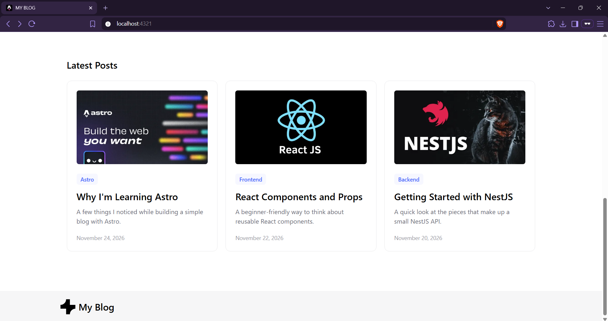

# My Blog

A small technology blog built while learning Astro. It has a homepage with recent posts and individual articles about Astro, React, and NestJS. The posts are written in Markdown, so adding one does not require building a new page by hand.



## What it uses

- **Astro 7** for pages, layouts, and static post routes
- **Astro content collections** to validate post details and load Markdown
- **Tailwind CSS 4** for styling
- **Astro's image tools** to optimize post covers

The homepage lists posts from newest to oldest. Each card links to a generated `/blog/<post-id>/` page with the post's title, date, cover image, and article text.

## Run locally

You need **Node.js 22.23.4 or newer** and npm.

```sh
npm install
npm run dev -- --background
```

Open the local URL reported by Astro (normally `http://localhost:4321`). To check the background server or stop it, run `npm run astro -- dev status` or `npm run astro -- dev stop`.

To build the static site and preview the output:

```sh
npm run build
npm run preview
```

## Add a blog post

Create a Markdown file in `src/content/blog/`. Its filename becomes the post ID used in its URL. The `blog` collection schema in `src/content.config.ts` requires a title, description, category, publication date, cover image, and cover alt text:

```md
---
title: "My New Post"
description: "A short summary for the homepage card."
category: "Frontend"
pubDate: 2026-11-25
cover: "../../assets/my-cover.png"
coverAlt: "A description of the cover image"
---

Write the article here. You can use headings, lists, and fenced code blocks.
```

Place the cover file in `src/assets/` (the example path is relative to `src/content/blog/`). Astro validates the frontmatter, adds the post to the homepage, and generates its article page during the build.

## Project map

| Path | Purpose |
| --- | --- |
| `src/content/blog/` | Markdown articles |
| `src/content.config.ts` | Blog collection and frontmatter schema |
| `src/pages/index.astro` | Homepage |
| `src/pages/blog/[...slug].astro` | Generates a route for each article |
| `src/components/LatestPost.astro` | Homepage post cards |
| `src/layouts/BlogPost.astro` | Shared article layout |

The switch in the header is currently visual only; it does not change the site's theme yet.
